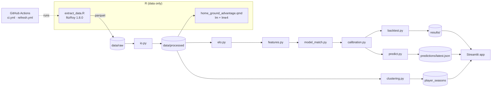

# Architecture

## Design principles

1. **R touches data only.** fitzRoy is the best AFL data source and has no Python equivalent; everything
   else is Python. The two halves communicate through parquet files, never `reticulate`
   ([ADR-001](docs/adr/ADR-001-hybrid-r-python.md)). The one other R artefact, the Quarto report, only
   *reads* the processed tables, so R never sits in the prediction path.
2. **Nothing downstream calls an API.** The dashboard and CI read committed artefacts. Squiggle is a
   courtesy service, so only the extract step touches it, with an identifying User-Agent and a contact email.
3. **Dates, not round numbers.** Every ordering and "before" check uses kickoff dates, so the 2024+ Opening
   Round (labelled "R1" by AFL Tables and round 0 by Squiggle) can never cause an off-by-one
   ([ADR-003](docs/adr/ADR-003-walk-forward-and-leakage.md)).
4. **Reproducible offline.** Match-level raw data and every derived table the scoring needs are committed;
   CI rebuilds them and fails if the leaderboard changes.
5. **The deployed app stays light.** `footyforecast.style` and `similarity` import only pandas and NumPy, so
   Streamlit Cloud installs the lean root `requirements.txt` (no scikit-learn, XGBoost, SHAP or UMAP); development uses `requirements-dev.txt`.

## Layers

| Layer | Modules | Output |
|---|---|---|
| Extract | `R/extract_data.R` | `data/raw/*.parquet`, `_manifest.json` |
| Normalise | `io.py` + `data/reference/*.csv` | `matches`, `squiggle_tips`, `bookmaker_footywire`, `player_games`, `team_games` |
| Rate | `elo.py` | walk-forward ratings, venue/travel HGA, per-season tuning |
| Features | `features.py` | 29 as-of pre-match features |
| Model | `model_match.py`, `calibration.py` | OOS probabilities, margins and per-game SHAP values |
| Evaluate | `benchmark.py`, `evaluation/` | leaderboard, bootstrap, calibration plots |
| Explain | `explain.py` | plain-English reason per tip, global SHAP plots |
| Players | `clustering.py`, `similarity.py` | archetypes, "plays like" |
| Publish | `predict.py` | `predictions/latest.json` and per-round archive |

## Automation

`ci.yml` (every push/PR): lint, rebuild tables and features, tests, re-score the backtest, fail on any
leaderboard diff. `refresh.yml` (in season, Tue and Thu UTC): incremental extract, rebuild, refit, re-score,
predict, commit. Secrets: `FOOTY_CONTACT_EMAIL` only.

## Limitations

- Raw **player-level** extracts are gitignored (large), so the weekly job cannot refresh player stats. New
  games fall back to each team's last known line-up until official selections are wired in, and archetypes are
  re-clustered by hand once per season.
- Fryzigg has no 2026 data; 2026 player stats come from the AFL source (cross-checked on 2025).
- Elo parameters for 2027 come from the walk-forward schedule (`results/elo_params_by_season.csv`); re-run
  `make tune` each pre-season.
- Not a betting product. Probabilities are calibrated, but the market is still better (see the leaderboard).
