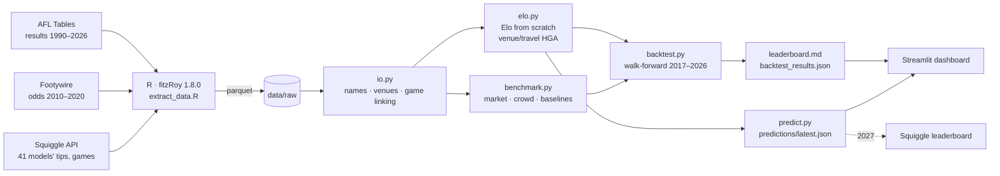

# 🏉 FootyForecast: Calibrated AFL Predictions, Benchmarked Against the Field

> AFL match predictions (win probability + margin) from an Elo system built from first
> principles. They are scored walk-forward over ten seasons against the betting market and every
> public model on [Squiggle](https://squiggle.com.au), using Squiggle's own metrics. Hybrid
> pipeline: R (fitzRoy) for data extraction, Python for everything else.

**Status:** Phase 1 (MVP) complete. Model and data pipeline, leaderboard, 2-tab dashboard.
Next: ML + calibration, player archetypes, a live **2027 Squiggle entry**. See [Roadmap](#-roadmap).

| Asset | Link |
|---|---|
| 🏉 Dashboard (Streamlit) | _deploying: run locally with `.\make.ps1 app`_ |
| 🏆 FootyForecast vs the field | [results/leaderboard.md](results/leaderboard.md) |
| 📡 Tips feed (Squiggle-ready) | [predictions/latest.json](predictions/latest.json) |

---

## 🏆 Results: walk-forward, 2017–2026 (2,063 games)

Every tip was made **before its round, using only earlier results**. Before each season the Elo
settings were re-tuned on the previous ten seasons only, the same process the live model runs
each pre-season.

| # | Model | Tips | Accuracy | Bits | Bits / season | Margin MAE |
|---|---|---:|---:|---:|---:|---:|
| 1 | Punters (betting market, via Squiggle) | 1,431 | 69.4% | 342.2 | 34.2 | 25.56 |
| 2 | Matter of Stats | 1,408 | 68.3% | 324.2 | 32.4 | 26.25 |
| 3 | Squiggle Aggregate (wisdom of crowds) | 1,420 | 68.8% | 321.9 | 32.2 | 26.12 |
| 4 | Squiggle | 1,408 | 68.3% | 310.6 | 31.1 | 26.51 |
| 5 | Graft | 1,395 | 67.6% | 287.6 | 28.8 | 26.70 |
| **6** | **FootyForecast Elo** | **1,415** | **68.6%** | **274.6** | **27.5** | **26.79** |
| 7 | ↳ ablation: parameters frozen at 2000–16 | 1,407 | 68.2% | 271.8 | 27.2 | 27.06 |
| 8 | ↳ ablation: flat home-ground advantage | 1,392 | 67.5% | 268.8 | 26.9 | 26.92 |
| 9 | Baseline: higher on the ladder | 1,314 | 63.7% | 100.7 | 10.1 | – |
| 10 | Baseline: home team | 1,187 | 57.5% | 29.4 | 2.9 | 30.74 |

**Bits** is the Monash probabilistic-tipping score Squiggle ranks models by: confident correct
tips earn more and confident wrong ones cost more, and a coin flip scores 0. Full per-season tables and
a same-games comparison with all 41 Squiggle sources are in [the leaderboard](results/leaderboard.md).

> **Honest read.** A scores-only Elo is a solid, explainable baseline: its tip accuracy (68.6%)
> edges Matter of Stats and Squiggle (68.3%), and it would have finished **2nd of 18 on bits in 2019**. On bits
> and margin it trails the market and the strongest models, especially since 2022, and its
> reliability diagram shows it is **under-confident at the extremes**. Closing that gap with
> team-selection/player-rating features and a calibration layer is Phase 2. If ML can't beat
> Elo, Elo stays the headline and the ML is written up as a negative result.

**What the ablations show:** venue- and travel-aware home-ground advantage beats the best flat
HGA (+3.0 bits out of sample), and walk-forward re-tuning adds another +2.8 bits and −0.27 MAE.

**Metric check:** the scoring code reproduces Squiggle's published per-tip bits (to within 0.01)
for **100% of 45,249 tips**, so the comparison is like-for-like.

---

## 📐 Architecture



R touches data only: fitzRoy is the best-maintained AFL data source and has no Python equivalent.
Everything else is Python. The two halves talk through parquet files, with no `reticulate`
([CLAUDE.md §1.2](CLAUDE.md)).

---

## 🧠 How the Elo works

- Every club starts at 1500, and expansion clubs (Gold Coast, GWS) start at 1300.
  P(home win) = 1 / (1 + 10^(−(R_home − R_away + HGA)/400)).
- **Margin-aware, zero-sum update.** The margin is mapped linearly onto [0, 1] over ±80 points,
  so a 60-point win moves ratings more than a 2-pointer. 2020 margins are scaled ×1.25 to
  allow for that season's 16-minute quarters.
- **Venue-aware home-ground advantage.** HGA = base + w·(ground familiarity gap) + w·(travel
  gap), using games at the venue in the past two years and great-circle km from each club's
  base. Geelong at Kardinia Park earns a big edge; two MCG tenants get almost none; the 2020
  hubs are neutral without any special-casing.
- Ratings regress 10% towards the mean between seasons to allow for list turnover.
- **Leakage safety.** Each round is tipped using only results dated before its first game. A
  postponed game's result is never used early. Ordering is always by date, because AFL Tables
  labels the 2024+ Opening Round "R1" while Squiggle calls it round 0. Tests change future
  results and check that past predictions don't move.

---

## 🛠️ Tech stack

| Layer | Tools |
|---|---|
| Extraction | R 4.5, **fitzRoy 1.8.0**, nanoparquet, renv |
| Modelling | Python 3.12/3.13, pandas, NumPy (Elo from scratch); XGBoost, scikit-learn, SHAP, UMAP in later phases |
| Evaluation | Walk-forward backtest; tips, bits, MAE, Brier, log loss, ECE, reliability diagrams |
| App | Streamlit + Plotly (colour-blind-validated palette) |
| Quality | pytest (27 tests incl. leakage guards), ruff, pre-commit + detect-secrets, GitHub Actions CI |

## 📊 Data sources & etiquette

| Source | Used for | Notes |
|---|---|---|
| [AFL Tables](https://afltables.com) via fitzRoy | Results 1990–2026 | Elo warm-up from 1990 |
| [Footywire](https://www.footywire.com) via fitzRoy | Head-to-head odds 2010–2020 | Coverage ends in 2020 |
| [Squiggle API](https://api.squiggle.com.au) via fitzRoy | Every public model's tips, the betting-market consensus ("Punters"), game ids, fixture | Identifying User-Agent with a contact email, whole seasons pulled once, ≥1 s between requests, cached; never called by the dashboard |

Champion Data's licensed statistics are **not** used. All data is cached in `data/raw/` with a
manifest (`_manifest.json`) recording row counts, seasons and the fitzRoy version.

---

## 🚀 Getting started

Windows (PowerShell):

```powershell
.\make.ps1 setup      # Python venv + deps
.\make.ps1 r-setup    # renv + fitzRoy 1.8.0 (optional: raw data is committed)
.\make.ps1 all        # build tables -> walk-forward backtest -> predictions feed
.\make.ps1 app        # dashboard on http://localhost:8501
```

macOS/Linux: the same targets via `make setup`, `make all`, `make app`.

To re-pull data (needs R and a `.env` with `FOOTY_CONTACT_EMAIL`, see `.env.example`):
`.\make.ps1 extract -Refresh`. To re-tune Elo: `.\make.ps1 tune` (about 2 minutes).

## 🧪 Reproducing the backtest

```powershell
.\make.ps1 build; .\make.ps1 backtest; .\make.ps1 test
```

CI does the same on every push from the committed raw extracts, with no network, R or secrets.
It fails if `results/leaderboard.md` changes.

---

## 🗺️ Roadmap

- [x] **Phase 1, MVP:** R extract, name/venue normalisation, Elo from scratch, baselines, walk-forward backtest, leaderboard, 2-tab dashboard, CI
- [ ] **Phase 2:** pre-match feature set (form, rest, travel, team-selection strength from player ratings), XGBoost win + margin models, isotonic/Platt calibration
- [ ] **Phase 3:** player-archetype clustering (Fryzigg stats → PCA/UMAP → K-means/GMM, validated against positions), similarity tool, SHAP explanations in plain English
- [ ] **Phase 4:** R Quarto report on home-ground advantage, weekly in-season refresh workflow, ARCHITECTURE/METHODOLOGY docs and ADRs
- [ ] **Phase 5:** deploy to Streamlit Community Cloud, demo GIF, register for the **2027 Squiggle leaderboard**

## 📁 Repository layout

```
R/                    fitzRoy extract (+ renv setup)
data/raw/             immutable extracts (parquet) + manifest
data/reference/       team aliases, team bases, venues (lat/lon), venue aliases
data/processed/       canonical matches, Squiggle tips, bookmaker probabilities, ratings
src/footyforecast/    io · elo · benchmark · predict · evaluation/{metrics, backtest}
results/              leaderboard, backtest results, tuning grids, per-season parameters
predictions/          latest.json feed + per-round archive
app/                  Streamlit dashboard
tests/                metrics, Elo maths + leakage, linking, backtest reproducibility
```

## 🎓 About

Built by **Karthik Reddy Tanigundala** (RMIT Master of Data Science) as part of a data portfolio
for Data Scientist / Data Analyst roles in Melbourne.
[LinkedIn](https://linkedin.com/in/karthik-reddy-datascience) ·
[GitHub](https://github.com/KarthikReddy-Tanigundala)
