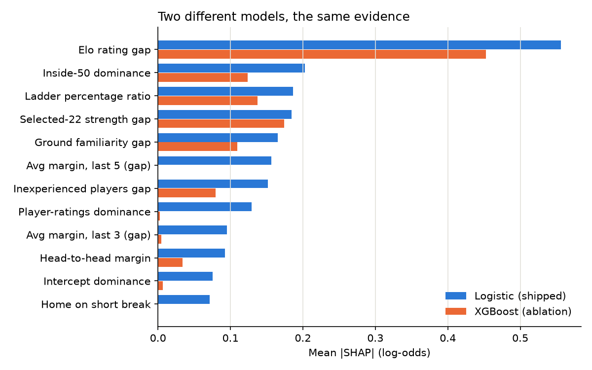
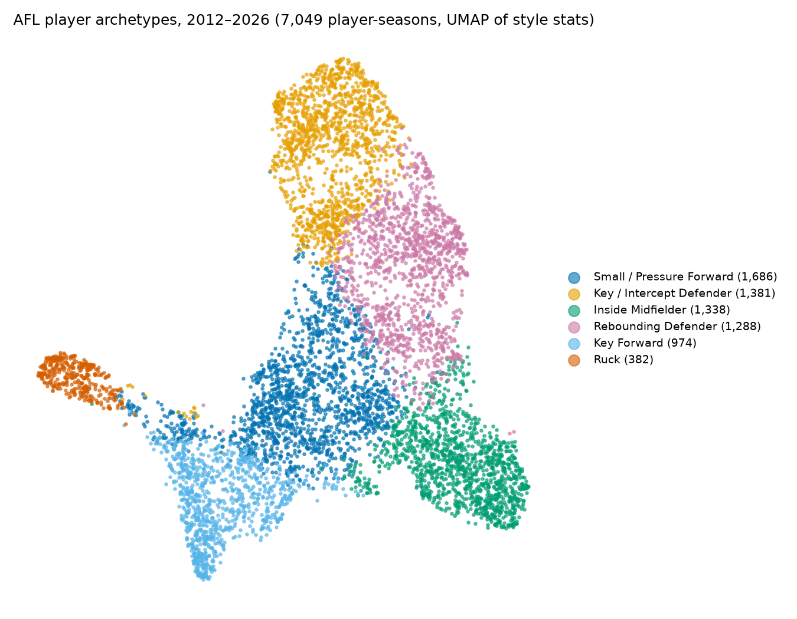
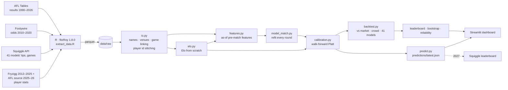

# 🏉 FootyForecast: Calibrated AFL Predictions, Benchmarked Against the Field

> AFL match predictions (win probability + margin) from a from-scratch Elo system and a
> pre-match feature model. Both are scored walk-forward over ten seasons against the betting market and
> every public model on [Squiggle](https://squiggle.com.au), using Squiggle's own metrics.
> Every tip comes with a plain-English reason, and players are clustered into six playing-style
> archetypes with a "plays like" similarity tool.
> Hybrid pipeline: R (fitzRoy) for data extraction, Python for everything else.

**Status:** Phase 4 complete. Predictions, calibration, explanations, archetypes, similarity, 4-tab dashboard,
R home-ground report, weekly refresh, docs. Next: deploy and a live **2027 Squiggle entry**.
See [Roadmap](#-roadmap).

| Asset | Link |
|---|---|
| 🏉 Live dashboard (Streamlit, 4 tabs) | [best-footyforecast-victoria.streamlit.app](https://best-footyforecast-victoria.streamlit.app/) |
| 🏆 FootyForecast vs the field | [results/leaderboard.md](results/leaderboard.md) |
| 📈 Calibration | [results/calibration_plot.png](results/calibration_plot.png) |
| 🧠 Player archetypes | [results/cluster_viz.png](results/cluster_viz.png) |
| 🔎 What drives the model (SHAP) | [results/shap_beeswarm.png](results/shap_beeswarm.png) |
| 📐 R report: is home advantage real? | [results/home_ground_advantage.html](results/home_ground_advantage.html) |
| 📚 Architecture · Methodology · ADRs | [ARCHITECTURE.md](ARCHITECTURE.md) · [METHODOLOGY.md](METHODOLOGY.md) · [docs/adr](docs/adr) |
| 📡 Tips feed (Squiggle-ready) | [predictions/latest.json](predictions/latest.json) |

---

## 🏆 Results: walk-forward, 2017–2026 (2,063 games)

Every tip was made **before its round, using only earlier games**. The Elo is re-tuned each
pre-season on the previous ten seasons. The ML models are refit before every round. Calibration maps
use the previous three seasons' out-of-sample predictions. Every modelling choice (classifier,
hyperparameters, margin model) was made on 2014–2016 warm-up seasons, never on the seasons scored
here. The one exception is the final pick among three candidates, which follows a rule fixed in advance
(most bits) and is disclosed as a small optimistic bias. The 2027 live season is the clean test.

| # | Model | Tips | Accuracy | Bits | Bits / season | Margin MAE |
|---|---|---:|---:|---:|---:|---:|
| 1 | Punters (betting market, via Squiggle) | 1,431 | 69.4% | 342.2 | 34.2 | 25.56 |
| 2 | Matter of Stats | 1,408 | 68.3% | 324.2 | 32.4 | 26.25 |
| 3 | Squiggle Aggregate (wisdom of crowds) | 1,420 | 68.8% | 321.9 | 32.2 | 26.12 |
| 4 | Squiggle | 1,408 | 68.3% | 310.6 | 31.1 | 26.51 |
| **5** | **FootyForecast ML (logistic + Platt): shipped** | **1,404** | **68.1%** | **294.3** | **29.4** | **26.39** |
| 6 | FootyForecast Elo + Platt | 1,417 | 68.7% | 288.7 | 28.9 | 26.79 |
| 7 | Graft | 1,395 | 67.6% | 287.6 | 28.8 | 26.70 |
| 8 | FootyForecast Elo (Phase 1) | 1,415 | 68.6% | 274.6 | 27.5 | 26.79 |
| 9 | Baseline: higher on the ladder | 1,314 | 63.7% | 100.7 | 10.1 | – |
| 10 | Baseline: home team | 1,187 | 57.5% | 29.4 | 2.9 | 30.74 |

_Ablations (logistic uncalibrated, XGBoost raw/Platt/isotonic, frozen and flat-HGA Elo) are in
[the leaderboard](results/leaderboard.md), along with a same-games comparison against all 41
Squiggle sources._

**Bits** is the Monash probabilistic-tipping score Squiggle ranks models by: confident correct
tips earn more and confident wrong ones cost more, and a coin flip scores 0. The scoring code
reproduces Squiggle's published per-tip bits (within 0.01) for **100% of 45,249 tips**.

### The honest read

- **The shipped model beats the Phase 1 Elo by +19.6 bits and −0.40 MAE**, and on Squiggle's
  2022–2026 tables it moves from the bottom quartile to mid-table (10th–14th of 24–27).
- **Is it real?** A round-clustered paired bootstrap puts the gain over Elo at
  **+19.6 [−5.0, +43.8]** bits, ahead in 94% of resamples: suggestive, not conclusive. Against
  *calibrated* Elo the edge is **+5.6 [−16.9, +28.4]**, which is indistinguishable.
- **Most of the gain is calibration.** Platt scaling alone is worth +14 bits to Elo (ECE 0.040 →
  0.020), because raw Elo was under-confident at the extremes. A log-loss-trained logistic is
  calibrated by construction, so Platt does nothing for it (the uncalibrated logistic scores
  1.3 bits more, well inside the noise).
- **The market is still clearly better** (−48 bits [−71, −25]), and so is the Squiggle
  Aggregate (−28 [−49, −7]). No claim of beating the bookies is made here.

### What the modelling choices show

- **Linear beats boosted trees here.** On the warm-up seasons XGBoost's best setting was 300
  depth-1 *stumps*, and a regularised logistic regression still beat it (log loss 0.558 vs 0.571).
  With ~200 games a season the signal is essentially additive. XGBoost is reported as an ablation.
- **Isotonic calibration overfits** about 600 calibration games (265 bits vs 289 for Platt on the same XGBoost).
- **Venue- and travel-aware home-ground advantage** beats a flat HGA (+3.0 bits). Re-tuning Elo
  each pre-season adds +2.8.

---

## 💬 Every tip, explained

The shipped model is a logistic regression, so its SHAP values are exact (coefficient ×
standardised feature, verified against `shap.LinearExplainer`). The 29 features are grouped into
footy reasons. Each reason is reported as how far the tip would move if that factor were neutral,
passed through the same calibration map that produced the probability. For example, the 2019
Round 1 tip (Brisbane won by 64):

> **Brisbane Lions 70% over West Coast**: +20 pts Brisbane Lions' stronger selected 22 (West Coast
> made 6 changes); −12 pts West Coast's higher Elo rating (1599 v 1436); +6 pts West Coast's recent
> form edge discounted (already priced into the Elo rating)

Reasons are written to be **factual**. With correlated features a model can lean *against* a team's
edge: with the Elo gap already in, recent margins get a negative weight, a mean-reversion
correction. The text then says the edge was discounted rather than inventing a reason. A guard
checks that every explanation reproduces the exact probability that was scored.



Two very different models lean on the same evidence: the Elo gap, inside-50 dominance, ladder
percentage, selected-22 strength and ground familiarity.

---

## 🧠 Player archetypes & "plays like"



Built from **7,049 player-seasons (2012–2026)**: players with at least 8 games at 50%+ time on
ground, 38 per-game style stats, each **z-scored within its own season** so eras compare fairly.
Then PCA (90% variance), K-means, and a Gaussian mixture for hybrids. **K = 6** was chosen by
silhouette within 6–9 (matching the six archetypes earlier public AFL work found), never by the
position labels used to validate it. Names come from domain templates matched to cluster
profiles by the Hungarian algorithm, so they aren't eyeballed.

| Archetype | Player-seasons | Most often named at | Share | Captures |
|---|---:|---|---:|---:|
| Small / Pressure Forward | 1,686 | General Forward | 60% | 56% of them |
| Key / Intercept Defender | 1,381 | General Defender | 53% | 43% |
| Inside Midfielder | 1,338 | Midfielder | 70% | 83% |
| Rebounding Defender | 1,288 | General Defender | 61% | 47% |
| Key Forward | 974 | Key Forward | 51% | 75% |
| Ruck | 382 | Ruck | 90% | 96% |

**Validation:** ARI 0.35 and NMI 0.48 against named positions. Named positions are team-sheet slots
and a noisy label, so partial agreement is expected. Defenders split by *style* (spoil/intercept vs
rebound) rather than by key vs general position, and 27% of player-seasons are hybrids
(mixture membership < 70%).

**"Plays like"** (cosine similarity on the season-relative profile, any era):
Max Gawn 2026 → Rowan Marshall 2019, Brodie Grundy 2019 · Charlie Curnow 2026 → Tom Lynch 2019,
Harry McKay 2021 · Marcus Bontempelli 2026 → Hugh McCluggage 2025, Joel Selwood 2012 ·
Jeremy McGovern 2024 → Steven May 2022.

---

## 📐 Architecture



R touches data only: fitzRoy is the best-maintained AFL data source and has no Python equivalent.
Everything else is Python, and the two talk through parquet files ([CLAUDE.md §1.2](CLAUDE.md)).

---

## 🧠 How it works

**Elo (from first principles).** Margin-aware, zero-sum updates. Ratings regress 10% to the mean
between seasons. Expansion clubs start low. Home-ground advantage is built from **ground
familiarity** (games at the venue in the last two years) and **travel** (great-circle km from each
club's base). Geelong at Kardinia Park earns a big edge; two MCG tenants get almost none; the 2020
hubs come out neutral automatically.

**Pre-match features (29).** Elo rating gap and HGA; recent form (last 3/5 margins and wins);
rest days and short breaks; ladder rank and percentage *as they stood*; head-to-head; rolling
"dominance" in contested possessions, clearances, inside-50s, metres gained, intercepts, tackles
and AFL Player Ratings; and **team selection**: the best-22 sum of the selected players' recent
ratings, the number of changes, and inexperienced players. Selections are public before the
round, and the players' ratings come only from earlier games.

**Leakage is prevented by construction and then tested:**
- Every feature is attached with an *as-of* join, keeping only history dated strictly before the
  round's first game.
- A test **scrambles every result and stat after a date and checks that no earlier feature
  changes**. It caught a real leak during the build: the debutant-rating fallback was a global
  average that included future debuts. That value is now computed as-of too.
- Models train on games *played* before the round. A fold guard caught a postponed game that
  would otherwise have leaked into training.
- AFL Tables labels the 2024+ Opening Round "R1" while Squiggle calls it round 0, so nothing is
  ever joined or ordered on round numbers.

**Player data.** Fryzigg has no 2026 data, so the official AFL source fills 2025–26. On the
overlapping 2025 season the two sources agree on 99.6% of player ratings, and 2026 players are
mapped onto their Fryzigg history.

---

## 🛠️ Tech stack

| Layer | Tools |
|---|---|
| Extraction | R 4.5, **fitzRoy 1.8.0**, nanoparquet, renv |
| Modelling | Python 3.12/3.13, pandas, NumPy, **scikit-learn** (logistic, ridge, Platt/isotonic), **XGBoost** |
| Evaluation | Walk-forward backtest; tips, bits, MAE, Brier, log loss, ECE; reliability diagrams; round-clustered paired bootstrap |
| App | Streamlit + Plotly (colour-blind-validated palette) |
| Explainability | SHAP (LinearExplainer for the shipped model, TreeExplainer for XGBoost), counterfactual plain-English reasons |
| Clustering | PCA → K-means + Gaussian mixture, UMAP (display only), Hungarian template naming, cosine similarity |
| Quality | pytest (42 tests incl. perturbation leakage tests and SHAP equivalence), ruff, pre-commit + detect-secrets, GitHub Actions CI |

## 📊 Data sources & etiquette

| Source | Used for | Notes |
|---|---|---|
| [AFL Tables](https://afltables.com) via fitzRoy | Results 1990–2026 | Elo warm-up from 1990 |
| [Fryzigg](https://github.com/jimmyday12/fitzRoy) via fitzRoy | Player stats + AFL Player Ratings 2012–2025 | Raw extract gitignored (~5 MB); derived tables committed |
| AFL.com.au via fitzRoy | Player stats 2025–2026 | Fills Fryzigg's 2026 gap; cross-checked on 2025 |
| [Footywire](https://www.footywire.com) via fitzRoy | Head-to-head odds 2010–2020 | Coverage ends in 2020 |
| [Squiggle API](https://api.squiggle.com.au) via fitzRoy | Every public model's tips, the market consensus ("Punters"), game ids, fixture | Identifying User-Agent with contact email, whole seasons pulled once, ≥1 s between requests, cached; never called by the dashboard |

Champion Data's licensed statistics are **not** used. `data/raw/_manifest.json` records row counts,
seasons and the fitzRoy version for every extract.

---

## 🚀 Getting started

Windows (PowerShell):

```powershell
.\make.ps1 setup      # Python venv + deps
.\make.ps1 all        # build tables -> features -> walk-forward backtest -> predictions feed
.\make.ps1 app        # dashboard on http://localhost:8501
```

macOS/Linux: the same targets via `make setup`, `make all`, `make app`.

| Task | Command | Time |
|---|---|---|
| Re-pull data (needs R + `.env` with `FOOTY_CONTACT_EMAIL`) | `.\make.ps1 extract -Refresh` | ~8 min |
| Re-tune Elo (grid + walk-forward schedule) | `.\make.ps1 tune` | ~2 min |
| Refit the ML walk-forward (add `-Tune` to redo the 2014–16 grid) | `.\make.ps1 ml` | ~1 min (+5) |
| Render the R report | `.\make.ps1 report` | ~1 min |
| Re-cluster archetypes (needs raw player stats) / redraw SHAP plots | `.\make.ps1 archetypes`, `.\make.ps1 explain` | ~1 min / seconds |
| Tests / lint | `.\make.ps1 test`, `.\make.ps1 lint` | seconds |

CI rebuilds the tables and features from committed data and re-scores the backtest, with no network,
R or secrets. It fails if `results/leaderboard.md` changes. ML out-of-sample predictions are
committed artefacts, so re-scoring is deterministic.

---

## 🗺️ Roadmap

- [x] **Phase 1, MVP:** R extract, name/venue normalisation, Elo from scratch, baselines, walk-forward backtest, leaderboard, dashboard, CI
- [x] **Phase 2, ML + calibration:** 29 as-of pre-match features incl. team selection, walk-forward logistic/XGBoost/ridge, Platt + isotonic, reliability diagrams, bootstrap significance
- [x] **Phase 3, archetypes + explanations:** 6 validated playing-style archetypes, "plays like" similarity tool, exact-SHAP plain-English reason for every tip, Archetypes and Similarity dashboard tabs
- [x] **Phase 4:** R Quarto report on home-ground advantage (`lm` + `lme4`: ~7-point strength-adjusted edge, travel worth ~11 points for a 2,700 km trip, matching the Python Elo), weekly in-season refresh workflow, ARCHITECTURE/METHODOLOGY, 4 ADRs. Still to do: official team selections in the live feed
- [ ] **Phase 5:** deploy to Streamlit Community Cloud, demo GIF, register for the **2027 Squiggle leaderboard**

## 📁 Repository layout

```
R/                    fitzRoy extract (+ renv setup)
data/raw/             immutable extracts (parquet) + manifest; player-level raw gitignored
data/reference/       team aliases, team bases, venues (lat/lon), venue aliases
data/processed/       matches, Squiggle tips, odds, player_games, team_games, features, ratings,
                      player_seasons (archetypes + UMAP + style z-scores)
src/footyforecast/    io · elo · features · model_match · calibration · explain · benchmark · predict
                      clustering · similarity · style · evaluation/{metrics, backtest}
results/              leaderboard, calibration/SHAP/cluster plots, archetypes.json, backtest results,
                      tuning grids, ML OOS predictions (with per-game SHAP values)
predictions/          latest.json feed + per-round archive
app/                  Streamlit dashboard
tests/                metrics, Elo + feature leakage, linking, ML walk-forward, SHAP, clustering, reproducibility
```

## 🎓 About

Built by **Karthik Reddy Tanigundala** (RMIT Master of Data Science) as part of a data portfolio
for Data Scientist / Data Analyst roles in Melbourne.
[LinkedIn](https://linkedin.com/in/karthik-reddy-datascience) ·
[GitHub](https://github.com/KarthikReddy-Tanigundala)
