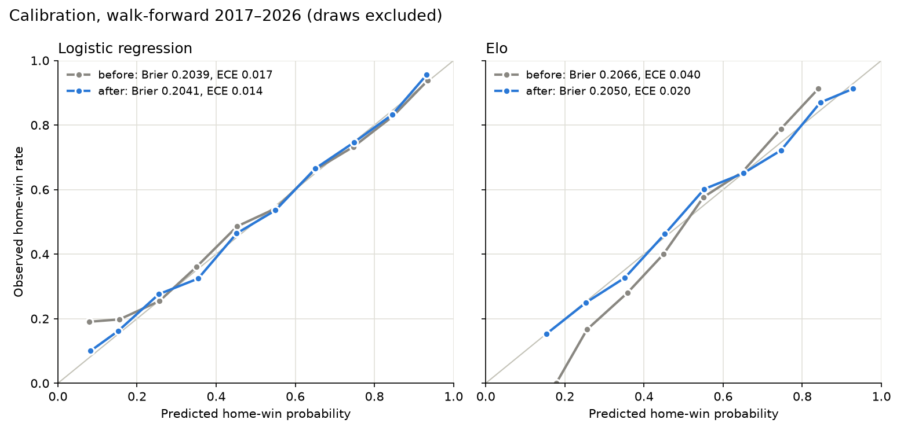

# FootyForecast vs The Field

Walk-forward backtest, **2017–2026** (2,063 games, 10 seasons). Every FootyForecast tip was made before its round using only earlier results. Before each season the Elo hyperparameters were re-tuned on the previous 10 seasons; the ML models were refit before every round; calibration maps were fitted on the previous three seasons' out-of-sample predictions only.

Metrics follow Squiggle: **tips** = correct winners (draws count as correct), **bits** = Monash probabilistic score (higher is better; a coin flip scores 0), **MAE** = mean absolute margin error in points.

**Shipped model: FootyForecast ML (logistic + Platt)** (bold below).

## Models that tipped every game

| # | Model | Type | Tips | Accuracy | Bits | Bits / season | MAE | Brier |
|---|---|---|---:|---:|---:|---:|---:|---:|
| 1 | Punters | Market | 1,431 | 69.4% | 342.2 | 34.2 | 25.56 | 0.1963 |
| 2 | Matter of Stats | Squiggle model | 1,408 | 68.3% | 324.2 | 32.4 | 26.25 | 0.1988 |
| 3 | Aggregate | Crowd | 1,420 | 68.8% | 321.9 | 32.2 | 26.12 | 0.1986 |
| 4 | Squiggle | Squiggle model | 1,408 | 68.3% | 310.6 | 31.1 | 26.51 | 0.2003 |
| 5 | Logistic (uncalibrated) | FootyForecast ablation | 1,402 | 68.0% | 295.6 | 29.6 | 26.39 | 0.2024 |
| 6 | **FootyForecast ML (logistic + Platt)** | FootyForecast | 1,404 | 68.1% | 294.3 | 29.4 | 26.39 | 0.2025 |
| 7 | XGBoost (uncalibrated) | FootyForecast ablation | 1,394 | 67.6% | 290.4 | 29.0 | 26.47 | 0.2031 |
| 8 | XGBoost + Platt | FootyForecast ablation | 1,393 | 67.5% | 289.4 | 28.9 | 26.39 | 0.2032 |
| 9 | FootyForecast Elo + Platt | FootyForecast | 1,417 | 68.7% | 288.7 | 28.9 | 26.79 | 0.2033 |
| 10 | Graft | Squiggle model | 1,395 | 67.6% | 287.6 | 28.8 | 26.70 | 0.2034 |
| 11 | FootyForecast Elo | FootyForecast | 1,415 | 68.6% | 274.6 | 27.5 | 26.79 | 0.2048 |
| 12 | Elo (frozen 2000–16 params) | FootyForecast ablation | 1,407 | 68.2% | 271.8 | 27.2 | 27.06 | 0.2055 |
| 13 | Elo (flat HGA) | FootyForecast ablation | 1,392 | 67.5% | 268.8 | 26.9 | 26.92 | 0.2059 |
| 14 | XGBoost + isotonic | FootyForecast ablation | 1,397 | 67.7% | 265.0 | 26.5 | 26.47 | 0.2046 |
| 15 | Higher ladder | Baseline | 1,314 | 63.7% | 100.7 | 10.1 | – | 0.2309 |
| 16 | Home team | Baseline | 1,187 | 57.5% | 29.4 | 2.9 | 30.74 | 0.2428 |

## Which FootyForecast model ships

Rule fixed before the evaluation was run: ship the candidate with the most bits over 2017–2026. Picking the best of three on the same window flatters the winner slightly; the 2027 live season is the clean out-of-sample test.

| Candidate | Bits | Accuracy | MAE | Brier | ECE |
|---|---:|---:|---:|---:|---:|
| **FootyForecast ML (logistic + Platt)** | 294.3 | 68.1% | 26.39 | 0.2025 | 0.014 |
| FootyForecast Elo + Platt | 288.7 | 68.7% | 26.79 | 0.2033 | 0.020 |
| FootyForecast Elo | 274.6 | 68.6% | 26.79 | 0.2048 | 0.040 |

### Is the difference real?

Paired bootstrap over rounds (2,000 resamples; rounds are resampled because games in a round are not independent). Δ is the shipped model's total bits minus the other model's over the same games.

| Shipped vs | Δ bits | 95% interval | Resamples where shipped is ahead |
|---|---:|---:|---:|
| FootyForecast Elo | +19.6 | [-5.0, +43.8] | 94% |
| FootyForecast Elo + Platt | +5.6 | [-16.9, +28.4] | 70% |
| Punters | -48.0 | [-71.0, -25.0] | 0% |
| Aggregate | -27.7 | [-49.0, -6.7] | 0% |

## Calibration

Brier score and expected calibration error (ECE: count-weighted |predicted − observed| over ten probability bins), pooled over the evaluation window, draws excluded.

| Model | Version | Brier | ECE |
|---|---|---:|---:|
| Logistic regression | raw | 0.2039 | 0.017 |
| Logistic regression | Platt-calibrated | 0.2041 | 0.014 |
| Elo | raw | 0.2066 | 0.040 |
| Elo | Platt-calibrated | 0.2050 | 0.020 |

## Season by season: FootyForecast vs the market and the crowd

| Season | FF tips | FF bits | FF MAE | Punters bits | Punters MAE | Aggregate bits | Aggregate MAE | FF rank (bits) |
|---|---:|---:|---:|---:|---:|---:|---:|---:|
| 2017 | 130 | 14.4 | 29.32 | 22.9 | – | 21.3 | 29.40 | 10 / 10 |
| 2018 | 144 | 35.0 | 26.34 | 39.8 | – | 37.3 | 26.63 | 8 / 15 |
| 2019 | 136 | 19.5 | 27.31 | 23.3 | 26.79 | 23.1 | 26.88 | 14 / 18 |
| 2020 | 116 | 21.2 | 23.59 | 27.1 | 22.77 | 20.8 | 23.10 | 7 / 16 |
| 2021 | 133 | 11.9 | 27.64 | 18.6 | 27.06 | 19.7 | 26.90 | 19 / 19 |
| 2022 | 142 | 37.7 | 24.84 | 42.5 | 24.15 | 39.4 | 24.52 | 13 / 27 |
| 2023 | 142 | 29.4 | 25.17 | 34.0 | 25.13 | 31.0 | 25.34 | 11 / 27 |
| 2024 | 143 | 28.3 | 27.24 | 28.9 | 26.82 | 30.2 | 26.64 | 10 / 24 |
| 2025 | 157 | 47.1 | 26.57 | 51.7 | 26.16 | 47.7 | 26.24 | 12 / 24 |
| 2026 | 161 | 49.5 | 25.38 | 53.6 | 24.96 | 51.4 | 24.95 | 14 / 25 |

## Same-games comparison with every Squiggle model

Many public models only tipped some seasons, so each one is compared with FootyForecast ML (logistic + Platt) on exactly the games both tipped. Positive Δ bits means FootyForecast scored more.

| Model | Seasons | Games | Their bits | FF bits | Δ bits | Their MAE | FF MAE |
|---|---|---:|---:|---:|---:|---:|---:|
| Punters | 2017–2026 | 2,063 | 342.2 | 294.3 | -48.0 | 25.56 | 26.39 |
| Bookmaker (Footywire) | 2017–2020 | 756 | 120.0 | 86.8 | -33.2 | 26.10 | 27.01 |
| Matter of Stats | 2017–2026 | 2,063 | 324.2 | 294.3 | -30.0 | 26.25 | 26.39 |
| Aggregate | 2017–2026 | 2,063 | 321.9 | 294.3 | -27.7 | 26.12 | 26.39 |
| s10 | 2018–2026 | 1,856 | 307.1 | 279.8 | -27.3 | 25.71 | 26.07 |
| AFLalytics | 2019–2026 | 1,649 | 268.0 | 244.8 | -23.1 | 25.65 | 26.03 |
| Wheelo Ratings | 2022–2026 | 1,073 | 210.6 | 192.2 | -18.4 | 25.26 | 25.85 |
| Live Ladders | 2018–2026 | 1,856 | 298.0 | 279.8 | -18.2 | 25.97 | 26.07 |
| Squiggle | 2017–2026 | 2,063 | 310.6 | 294.3 | -16.3 | 26.51 | 26.39 |
| Data by Josh | 2022–2024 | 626 | 103.6 | 96.0 | -7.6 | 25.40 | 25.58 |
| Figuring Footy | 2017–2017 | 207 | 19.7 | 14.4 | -5.2 | – | 29.32 |
| Drop Kick Data | 2022–2026 | 1,073 | 196.7 | 192.2 | -4.5 | 25.83 | 25.85 |
| Glicko Ratings | 2021–2026 | 1,280 | 208.0 | 204.1 | -3.9 | 26.06 | 26.14 |
| The Cruncher | 2021–2026 | 1,273 | 206.1 | 203.1 | -2.9 | 26.36 | 26.15 |
| Winnable | 2024–2026 | 650 | 127.4 | 125.0 | -2.4 | 26.22 | 26.39 |
| Swinburne | 2018–2020 | 576 | 78.1 | 75.7 | -2.3 | 26.69 | 25.92 |
| Logistic (uncalibrated) | 2017–2026 | 2,063 | 295.6 | 294.3 | -1.3 | 26.39 | 26.39 |
| In The Game | 2026–2026 | 218 | 49.7 | 49.5 | -0.2 | 26.31 | 25.38 |
| Cheap Stats | 2021–2026 | 1,277 | 203.3 | 203.5 | +0.2 | 26.40 | 26.14 |
| The Arc | 2017–2020 | 683 | 75.1 | 75.4 | +0.4 | 27.82 | 27.37 |
| HBin | 2026–2026 | 218 | 48.6 | 49.5 | +0.9 | 25.24 | 25.38 |
| Massey Ratings | 2018–2026 | 1,821 | 271.9 | 273.3 | +1.4 | 26.47 | 26.13 |
| Informed Stats | 2024–2026 | 650 | 123.0 | 125.0 | +2.0 | 27.03 | 26.39 |
| Don't Blame the Data | 2023–2026 | 866 | 151.8 | 154.4 | +2.7 | 26.37 | 26.09 |
| AFL_GO | 2020–2020 | 162 | 18.4 | 21.2 | +2.8 | 23.31 | 23.59 |
| ZaphBot | 2021–2026 | 1,280 | 200.4 | 204.1 | +3.7 | 26.53 | 26.14 |
| XGBoost (uncalibrated) | 2017–2026 | 2,063 | 290.4 | 294.3 | +3.9 | 26.47 | 26.39 |
| XGBoost + Platt | 2017–2026 | 2,063 | 289.4 | 294.3 | +4.9 | 26.39 | 26.39 |
| FootyForecast Elo + Platt | 2017–2026 | 2,063 | 288.7 | 294.3 | +5.6 | 26.79 | 26.39 |
| What Snoo Thinks | 2024–2026 | 628 | 121.4 | 128.0 | +6.6 | 26.61 | 26.39 |
| Graft | 2017–2026 | 2,063 | 287.6 | 294.3 | +6.7 | 26.70 | 26.39 |
| AFL Gains | 2019–2019 | 207 | 12.4 | 19.5 | +7.1 | 27.79 | 27.31 |
| AFL Lab | 2019–2026 | 1,649 | 237.5 | 244.8 | +7.3 | 26.09 | 26.03 |
| Fat Stats | 2019–2019 | 207 | 11.4 | 19.5 | +8.1 | 30.02 | 27.31 |
| FMI | 2017–2024 | 1,628 | 188.7 | 197.4 | +8.8 | 27.36 | 26.52 |
| footycharts | 2024–2026 | 646 | 114.7 | 125.3 | +10.6 | 26.93 | 26.32 |
| The Wooden Finger | 2022–2026 | 1,073 | 179.3 | 192.2 | +12.9 | 26.62 | 25.85 |
| Elo Predicts! | 2022–2026 | 1,073 | 178.0 | 192.2 | +14.1 | 26.42 | 25.85 |
| Holy Grail Ratings | 2026–2026 | 218 | 35.3 | 49.5 | +14.3 | 25.31 | 25.38 |
| Hyperion | 2022–2026 | 1,059 | 173.4 | 189.6 | +16.2 | 26.80 | 25.90 |
| FootyForecast Elo | 2017–2026 | 2,063 | 274.6 | 294.3 | +19.6 | 26.79 | 26.39 |
| Elo (frozen 2000–16 params) | 2017–2026 | 2,063 | 271.8 | 294.3 | +22.5 | 27.06 | 26.39 |
| The Flag | 2020–2023 | 792 | 77.6 | 100.3 | +22.6 | 26.39 | 25.41 |
| The Footycast | 2022–2026 | 1,071 | 167.3 | 192.1 | +24.8 | 26.14 | 25.82 |
| HPN | 2018–2019 | 414 | 29.3 | 54.5 | +25.3 | 29.46 | 26.82 |
| Elo (flat HGA) | 2017–2026 | 2,063 | 268.8 | 294.3 | +25.5 | 26.92 | 26.39 |
| XGBoost + isotonic | 2017–2026 | 2,063 | 265.0 | 294.3 | +29.2 | 26.47 | 26.39 |
| Stattraction | 2018–2026 | 1,856 | 249.3 | 279.8 | +30.6 | 26.85 | 26.07 |
| AFL Scorigami | 2022–2026 | 1,069 | 159.3 | 192.1 | +32.8 | 26.96 | 25.84 |
| PlusSixOne | 2017–2026 | 2,050 | 237.1 | 293.1 | +56.0 | 27.07 | 26.36 |
| Higher ladder | 2017–2026 | 2,063 | 100.7 | 294.3 | +193.6 | – | 26.39 |
| Home team | 2017–2026 | 2,063 | 29.4 | 294.3 | +264.9 | 30.74 | 26.39 |

## Notes

- **Honest framing:** the betting market and the Squiggle Aggregate are strong. Tips are a noisy metric, so judge models on bits and MAE across all ten seasons, not one lucky year.
- Bookmaker (Footywire) odds are de-vigged proportionally and only exist for 2010–2020, so they appear in the same-games table; Squiggle's *Punters* source carries the market from 2017 to today.
- **Metric check:** our bits implementation matches Squiggle's published per-tip bits within 0.01 for 100.0% of 45,249 tips, and margin error within 0.5 points for 99.9%.
- 2020 was played with 16-minute quarters, so margins (and MAE) run smaller that season.
- Player statistics: Fryzigg for 2012–2025 and the AFL source for 2026, cross-checked on 2025.
- Generated 2026-10-20 by `python -m footyforecast.evaluation.backtest`.
